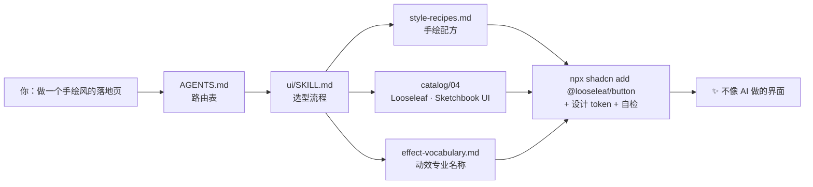

<p align="center">
  
</p>

<!-- AUTO:badges -->
<p align="center">     </p>
<!-- /AUTO:badges -->

<p align="center">
  <b>中文</b> · <a href="#english">English</a> ·
  <a href="AGENTS.md">AGENTS.md（AI 入口）</a> ·
  <a href="MASTER_PROMPT.md">一键提示词</a> ·
  <a href="INDEX.md">全部索引</a>
</p>

---

> **你的网页 UI 做得烂，不是你水平低。** 是 AI 不知道世界上有哪些好轮子，而你也说不出想要的效果叫什么。
>
> 这个仓库同时解决这两件事：把**几百个经过核实的组件库、动效词汇、Agent Skills、MCP、脚手架和架构参考**整理成 AI 读得懂的结构。把文件夹交给 Claude Code / Codex / Cursor，它会自己找到该用的东西，连安装命令都是现成的。

## ⚡ 30 秒上手

```bash
git clone --recursive <这个仓库的地址> ai-master-prompt
cd ai-master-prompt
./setup.sh                 # 检查环境、拉取子模块、跑一次自检。只需要 python3，零依赖
./setup.sh --link-skills   # 可选：把自带 Skill 装进 ~/.claude/skills，以后在任何项目里都能用
```

> 下载的是 ZIP 也没关系，`./setup.sh` 会自动补齐。Windows 用户可以直接用 `python scripts/find.py`，所有脚本只依赖 Python 标准库。

然后三选一：

| 方式 | 怎么做 | 适合 |
|---|---|---|
| **🤖 交给 AI Agent** | 在这个文件夹里打开 Claude Code / Codex / Cursor，或者对它说「参考 `<这个文件夹的路径>`，帮我……」 | 写代码、做项目（推荐） |
| **📋 粘贴提示词** | 复制 [MASTER_PROMPT.md](MASTER_PROMPT.md) 到任何 AI 聊天框 | ChatGPT / Gemini / v0 / Lovable |
| **🔎 自己搜** | `python3 scripts/find.py 液态玻璃` | 快速查一个库 / 一条命令 |

## 🧭 它是怎么工作的



AI 不需要通读整个仓库：`AGENTS.md` 只有一页，按「需求 → 文件」的路由表打开 1–3 个文件就能开工。每条资源都带**一句话说明、技术栈、价格和可以直接运行的安装命令**（`npx shadcn add`、`claude mcp add`、`npx skills add`……）。

## 📦 里面有什么

<!-- AUTO:stats -->
| 模块 | 内容 | 条目 | 分类 | 入口 |
|---|---|---:|---:|---|
| **`ui/`** | UI 组件 · 特效 · 动效词汇 · 设计 Skill · 灵感 · 素材 · MCP | 264 | 17 | [ui/SKILL.md](ui/SKILL.md) |
| **`skills/`** | Agent Skills 排行与精选 | 32 | 6 | [skills/README.md](skills/README.md) |
| **`tools/`** | 开源工具（采集 / 浏览器自动化） | 5 | 2 | [tools/README.md](tools/README.md) |
| **`scaffolds/`** | 脚手架 · Agent 框架 · MCP 模板 · 架构 · 元列表 | 81 | 7 | [scaffolds/README.md](scaffolds/README.md) |
| | **合计** | **382** | **32** | [INDEX.md](INDEX.md) |
<!-- /AUTO:stats -->

另外还有三份手写的「设计语言」文件，是这个仓库的灵魂：

- **[动效词汇速查表](ui/prompts/effect-vocabulary.md)**：100+ 个专业名称（Split Text Stagger、Sticky Stack Cards、Magnetic Button、Dolly Zoom……），每个都写了长什么样、用什么实现。
- **[风格配方](ui/prompts/style-recipes.md)**：11 种风格，每种都给出视觉特征、推荐库、安装命令和要避开的坑（手绘、新粗野、像素、终端、液态玻璃、Linear 风、杂志风……）。
- **[需求描述模板](ui/prompts/request-template.md)**：照着填，任何 AI 都能一次做对。

## ✨ 想要 X？直接用这个

| 想要 | 首选 | 一行命令 |
|---|---|---|
| 手绘笔记本风 | [Looseleaf](https://kevintngo.github.io/looseleaf/) · [Sketchbook UI](https://sarthakrawat-1.github.io/sketchbook-ui/) | `npm i sketchbook-ui` |
| 炫酷落地页 / Hero 特效 | [Magic UI](https://magicui.design) · [Aceternity](https://ui.aceternity.com) · [React Bits](https://reactbits.dev) | `npx shadcn add @magicui/marquee` |
| 稀有动画组件 | [Rare UI](https://www.rareui.com) · [Animate UI](https://animate-ui.com) · [Skiper UI](https://skiper-ui.com) | `npx shadcn add @animate-ui/<item>` |
| 会滴落、融合的液体效果 | [goopUI](https://goop.timmcmasters.work/docs/components)（Vue） · [Paper Shaders](https://shaders.paper.design) | — |
| 移动端液态玻璃 / 3D | [ExpoKit](https://expokit.in) · [beUI](https://beui.dev) | `npx @expokit/cli@latest add button` |
| AI 产品 / Agent 可观测性 | [affectUI](https://www.affectui.com) · [AI Elements](https://elements.ai-sdk.dev) · [assistant-ui](https://www.assistant-ui.com) | `npx shadcn add @ai-elements/<item>` |
| 说不出动效叫什么 | [motion-prompt](https://showheyohtaki.github.io/motion-prompt/)（192 个带演示） | `npx skills add showheyohtaki/motion-prompt` |
| 让 AI 有审美、去 AI 味 | [frontend-design](https://github.com/anthropics/skills/tree/main/skills/frontend-design) · [Impeccable](https://impeccable.style) · [UI UX Pro Max](https://github.com/nextlevelbuilder/ui-ux-pro-max-skill) | `npx skills add anthropics/skills --skill frontend-design` |
| 照着 Stripe / Linear 的风格做 | [awesome-design-md](https://github.com/VoltAgent/awesome-design-md) | 把对应 DESIGN.md 放进项目根目录 |
| Agent 直接装组件 | [shadcn MCP](https://ui.shadcn.com/docs/mcp)（接入 548 个 registry） | `npx shadcn@latest mcp init --client claude` |
| 新建 SaaS 项目 | [next-forge](https://www.next-forge.com) · [Open SaaS](https://opensaas.sh) | `npx next-forge@latest init` |
| 做 Agent / MCP Server | [Mastra](https://mastra.ai) · [Claude Agent SDK](https://docs.claude.com/en/docs/agent-sdk/overview) · [FastMCP](https://gofastmcp.com) | `npm create mastra@latest` |
| 采集小红书 / 抖音 / B站 | [MediaCrawler](https://github.com/NanmiCoder/MediaCrawler)（仅学习用途） | 见 [tools/README.md](tools/README.md) |
| 让 AI 自己找 Skill | [find-skills](https://skills.sh)（全球安装量 #1） | `npx skills add vercel-labs/skills --skill find-skills` |

## 💬 直接复制这些 Prompt 试试

```text
参考这个文件夹，用新粗野主义风格给我的番茄钟 App 做一个落地页，动效要有 Marquee 和 Magnetic Button。
```

```text
参考这个文件夹，我要做一个能看到 Agent 每一步调用和花费的控制台，帮我选组件并搭出来。
```

```text
参考这个文件夹，用 Expo 做一个带液态玻璃效果的天气 App，先告诉我你打算用哪些库。
```

```text
参考这个文件夹，帮我把 https://example.com 这个新组件库加进来（先核实，再按 CONTRIBUTING.md 写入并重新生成）。
```

## 🆚 为什么不直接用现有的网站？

2026-11-09 调研结论：**没有一个地方把这些全部汇总在一起**，每个现有站点只管一块。

| | 组件库 | 动效词汇 | 设计 Skill / DESIGN.md | MCP | Agent Skills | 脚手架 / 架构 | AI 可直接读 | 中文 |
|---|:-:|:-:|:-:|:-:|:-:|:-:|:-:|:-:|
| [21st.dev](https://21st.dev) | ✅ | | | ✅ | | | ✅ | |
| [shadcn Registry 目录](https://ui.shadcn.com/docs/directory) | ✅ | | | ✅ | | | ✅ | |
| [skills.sh](https://skills.sh) | | | ✅ | | ✅ | | ✅ | |
| [awesome-design-md](https://github.com/VoltAgent/awesome-design-md) | | | ✅ | | | | ✅ | |
| [motion-prompt](https://github.com/showheyohtaki/motion-prompt) | | ✅ | | | ✅ | | ✅ | ✅ |
| [awesome-ai-tools-for-ui](https://github.com/maxbogo/awesome-ai-tools-for-ui)（66 条） | 部分 | | ✅ | ✅ | ✅ | | | |
| **AI Master Prompt（本仓库）** | ✅ | ✅ | ✅ | ✅ | ✅ | ✅ | ✅ | ✅ |

本仓库不复制它们的内容，而是**把它们连起来**，并告诉 AI 什么情况该用哪个。

## 🗂️ 仓库结构

<details>
<summary>展开</summary>

```
AGENTS.md              ← AI 入口：路由表 + 使用规则（Claude Code / Codex / Cursor 自动读取）
CLAUDE.md              ← 指向 AGENTS.md
MASTER_PROMPT.md       ← 可直接粘贴进任何 AI 的总提示词
INDEX.md               ← 全部分类索引（自动生成）
setup.sh               ← 一键环境检查 / 子模块 / 安装 Skill
ui/
  SKILL.md             ← UI 路由 Skill：选型决策表、MCP、shadcn 命名空间、自检清单
  prompts/             ← 动效词汇 · 风格配方 · 需求模板（手写）
  catalog/01–12        ← 12 个分类目录（自动生成）
skills/                ← Skills 排行 + 精选 + 安装方式
tools/                 ← MediaCrawler 等开源工具
scaffolds/             ← Starter · Agent 框架 · MCP 模板 · 架构 · Awesome 元列表
lieflat-less-ai-tone/  ← 子模块：中文去 AI 味 Skill（原作者仓库，CC BY-NC 4.0）
data/                  ← categories.json + resources/*.json（唯一数据源）
scripts/               ← find.py 搜索 · build.py 生成 · check_links.py 查死链 · make_banner.py
assets/banner.svg      ← 本页头图（由 make_banner.py 生成，数字跟着数据自动更新）
```

</details>

## 🛠️ 维护与贡献

```bash
# 1. 编辑 data/resources/*.json（格式见 CONTRIBUTING.md）
python3 scripts/build.py          # 2. 重新生成目录、索引、README 徽章与统计、头图
python3 scripts/check_links.py    # 3. 可选：检查所有链接是否还活着
```

或者直接让 AI 做：「把 xxx 加进这个库」。详见 [CONTRIBUTING.md](CONTRIBUTING.md)。星数、安装量和价格是 2026-11-09 的快照，会随时间变化。

## 🙏 致谢与许可

- 本仓库自己的代码和文字以 [MIT](LICENSE) 许可发布。
- 收录的每个项目归其原作者所有，使用前请看各自的许可证（条目里带 ⚠ 的有特殊限制，例如 Rare UI 需要署名、MediaCrawler 禁止商用）。
- `lieflat-less-ai-tone` 以 git 子模块引用 [larashero3-dotcom/lieflat-less-ai-tone](https://github.com/larashero3-dotcom/lieflat-less-ai-tone)（CC BY-NC 4.0）。
- 头图设计用的正是本仓库的 [风格配方](ui/prompts/style-recipes.md)：终端配方 #4 加杂志配方 #7，动效是 Typewriter、Marquee 和 Dot Pattern。

---

<a id="english"></a>

## English

**AI Master Prompt** is a curated, AI-readable reference library. Hand this folder to any coding agent (Claude Code, Codex, Cursor…). It starts at [`AGENTS.md`](AGENTS.md), follows a one-page routing table, and finds the right UI library, motion vocabulary, agent skill, MCP server, starter template or architecture reference, each with a ready-to-run install command.

- **Quick start:** `git clone --recursive <repo> && cd <repo> && ./setup.sh`
- **Search:** `python3 scripts/find.py <keywords>` (stdlib only)
- **Paste-anywhere prompt:** [`MASTER_PROMPT.md`](MASTER_PROMPT.md)
- **Add entries:** edit `data/resources/*.json`, then run `python3 scripts/build.py`

Every entry was verified on 2026-11-09. Descriptions are in Chinese, but names, URLs and commands are universal.
