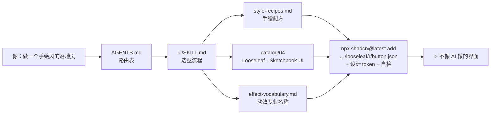

<p align="center">
  
</p>

<!-- AUTO:badges -->
<p align="center">      </p>
<!-- /AUTO:badges -->

<p align="center">
  <b>中文</b> · <a href="#english">English</a> ·
  <a href="AGENTS.md">AGENTS.md（AI 入口）</a> ·
  <a href="MASTER_PROMPT.md">一键提示词</a> ·
  <a href="INDEX.md">全部索引</a>
</p>

---

> **你的网页 UI 做得烂，不是你水平低。** 是 AI 不知道世界上有哪些好轮子，而你也说不出想要的效果叫什么。
>
> 这个仓库同时解决这两件事：把**约 2500 个组件库、功能组件、设计素材、动效词汇、Agent Skills、MCP、脚手架、云服务、AI 基础设施和架构参考**，外加 shadcn 官方索引的全部 548 个 registry，整理成 AI 读得懂的结构。把文件夹交给 Claude Code / Codex / Cursor，它会自己找到该用的东西，连安装命令都是现成的。

## ⚡ 30 秒上手

```bash
git clone --recursive https://github.com/Horace-Maxwell/ai-master-prompt.git
cd ai-master-prompt
./setup.sh                 # 检查环境、拉取子模块、跑一次自检。只需要 python3，零依赖
./setup.sh --link-skills   # 可选：把自带 Skill 装进 ~/.claude/skills，以后在任何项目里都能用
```

> - **`setup.sh` 是可选的**，不跑也能用：所有脚本只依赖 Python 3.9+ 标准库。它只是帮你检查环境、补齐子模块。
> - 下载的是 ZIP 也没关系，`./setup.sh` 会自动补齐子模块。
> - **Windows**：`setup.sh` 需要 Git Bash 或 WSL；不想装就跳过，直接 `python scripts/find.py 手绘`（把 `python3` 换成 `python` 或 `py -3`）。
> - 不想克隆？`npx skills add Horace-Maxwell/ai-master-prompt` 只装 UI 部分（Skill + 18 个目录 + 词汇表）到你的 Agent 里。

然后四选一：

| 方式 | 怎么做 | 适合 |
|---|---|---|
| **🤖 交给 AI Agent** | 在这个文件夹里打开 Claude Code / Codex / Cursor，或者对它说「参考 `<这个文件夹的路径>`，帮我……」 | 写代码、做项目（推荐） |
| **📋 粘贴提示词** | 复制 [MASTER_PROMPT.md](MASTER_PROMPT.md) 到任何 AI 聊天框 | ChatGPT / Gemini / v0 / Lovable |
| **🔗 丢一个链接或文件** | 把 [`llms-full.txt`](llms-full.txt)（手写指南 + 全部 ⭐ 精选合成的单个文件，约 100 KB）拖进聊天框；能联网的 AI 直接给它 `https://raw.githubusercontent.com/Horace-Maxwell/ai-master-prompt/main/llms.txt` | 不能读本地文件夹的 AI |
| **🔎 自己搜** | `python3 scripts/find.py 液态玻璃`，或者直接看 [PICKS.md](PICKS.md)（全部 ⭐ 首选，一页看完） | 快速查一个库 / 一条命令 |

## 🧭 它是怎么工作的



AI 不需要通读整个仓库：`AGENTS.md` 只有一页，按「需求 → 文件」的路由表打开 1–3 个文件就能开工；要默认选择就看 [PICKS.md](PICKS.md)，要具体的东西就搜索。每条资源都有**一句话说明和价格**，多数还带**可以直接运行的安装命令**（`npx shadcn@latest add`、`claude mcp add`、`npx skills add`……）。搜索支持中英文同义词，搜「玻璃」能找到 glass，搜「磁吸」能找到 Magnetic Button。

## 📦 里面有什么

<!-- AUTO:stats -->
| 模块 | 内容 | 条目 | 分类 | 入口 |
|---|---|---:|---:|---|
| **`ui/`** | 组件库（React / Vue / Svelte / 原生 / 国内生态）· 功能型组件 · 特效 · 动效词汇 · 设计系统 · 模板 · 灵感 · 素材 · MCP | 1286 | 25 | [ui/SKILL.md](ui/SKILL.md) |
| **`skills/`** | Agent Skills 排行与分领域精选 · 规则 / Prompt / 子 Agent 库 | 218 | 8 | [skills/README.md](skills/README.md) |
| **`tools/`** | MCP 目录与常用 MCP 服务器 · AI 编码工具 · 采集与浏览器自动化 | 232 | 5 | [tools/README.md](tools/README.md) |
| **`scaffolds/`** | 脚手架 · Agent 框架 · 服务与基础设施 · AI 基础设施 · 常用库 · 架构 · 元列表 | 792 | 11 | [scaffolds/README.md](scaffolds/README.md) |
| | **合计** | **2528** | **49** | [INDEX.md](INDEX.md) |
<!-- /AUTO:stats -->

除了上面的目录，还有这些：

- **[PICKS.md](PICKS.md)**：每个分类、每个子类的 ⭐ 默认选择，一页看完（认证用什么、图表用什么、向量库用什么……）。
- **[shadcn 官方索引全量](ui/catalog/18-shadcn-registries.md)**：全部 548 个 registry、约 14 万个可安装条目，任何一个都能 `npx shadcn@latest add @命名空间/条目` 直接装。

以及三份手写的「设计语言」文件，是这个仓库的灵魂：

- **[动效词汇速查表](ui/prompts/effect-vocabulary.md)**：80 多行、100 多个专业名称（Split Text Stagger、Sticky Stack Cards、Magnetic Button、Dolly Zoom……）。界面动效都写了长什么样、用什么实现，能直接安装的给出了核实过的条目名（如 `@magicui/border-beam`）。
- **[风格配方](ui/prompts/style-recipes.md)**：11 种风格，每种都给出视觉特征、推荐库和要避开的坑，有现成组件库的附安装命令（手绘、新粗野、像素、终端、液态玻璃、Linear 风、杂志风……）。
- **[需求描述模板](ui/prompts/request-template.md)**：照着填，任何 AI 都能一次做对。

## ✨ 想要 X？直接用这个

| 想要 | 首选 | 一行命令 |
|---|---|---|
| 手绘笔记本风 | [Looseleaf](https://kevintngo.github.io/looseleaf/) · [Sketchbook UI](https://sarthakrawat-1.github.io/sketchbook-ui/) | `npx shadcn@latest add https://kevintngo.github.io/looseleaf/r/button.json` |
| 炫酷落地页 / Hero 特效 | [Magic UI](https://magicui.design) · [Aceternity](https://ui.aceternity.com) · [React Bits](https://reactbits.dev) | `npx shadcn@latest add @magicui/marquee` |
| 稀有动画组件 | [Rare UI](https://www.rareui.com) · [Animate UI](https://animate-ui.com) · [Skiper UI](https://skiper-ui.com) | `npx shadcn@latest add swamimalode07/rare-ui/fluid-orb` |
| 会滴落、融合的液体效果 | [goopUI](https://goop.timmcmasters.work/docs/components)（Vue） · [Paper Shaders](https://shaders.paper.design) | — |
| 移动端液态玻璃 / 3D | [expo-glass-effect](https://docs.expo.dev/versions/latest/sdk/glass-effect/) · [ExpoKit](https://expokit.in) · [beUI](https://beui.dev) | `npx expo install expo-glass-effect` |
| AI 产品 / Agent 可观测性 | [affectUI](https://www.affectui.com) · [AI Elements](https://elements.ai-sdk.dev) · [assistant-ui](https://www.assistant-ui.com) | `npx shadcn@latest add @ai-elements/message` |
| 说不出动效叫什么 | [motion-prompt](https://showheyohtaki.github.io/motion-prompt/)（192 个带演示） | `npx skills add showheyohtaki/motion-prompt` |
| 让 AI 有审美、去 AI 味 | [frontend-design](https://github.com/anthropics/skills/tree/main/skills/frontend-design) · [Impeccable](https://impeccable.style) · [UI UX Pro Max](https://github.com/nextlevelbuilder/ui-ux-pro-max-skill) | `npx skills add anthropics/skills --skill frontend-design` |
| 照着 Stripe / Linear 的风格做 | [awesome-design-md](https://github.com/VoltAgent/awesome-design-md) | 把对应 DESIGN.md 放进项目根目录 |
| Agent 直接装组件 | [shadcn MCP](https://ui.shadcn.com/docs/mcp)（接入 548 个 registry） | `npx shadcn@latest mcp init --client claude` |
| 新建 SaaS 项目 | [next-forge](https://www.next-forge.com) · [Open SaaS](https://opensaas.sh) | `npx next-forge@latest init` |
| 做 Agent / MCP Server | [Mastra](https://mastra.ai) · [Claude Agent SDK](https://code.claude.com/docs/en/agent-sdk/overview) · [FastMCP](https://gofastmcp.com) | `npm create mastra@latest` |
| Python 多 Agent 客服 | [OpenAI CS Agents Demo](https://github.com/openai/openai-cs-agents-demo) · [LangGraph](https://langchain-ai.github.io/langgraph/) | `git clone https://github.com/openai/openai-cs-agents-demo` |
| 采集小红书 / 抖音 / B站 | [MediaCrawler](https://github.com/NanmiCoder/MediaCrawler)（仅学习用途） | 见 [tools/README.md](tools/README.md) |
| 让 AI 自己找 Skill | [find-skills](https://skills.sh)（全球安装量 #1） | `npx skills add vercel-labs/skills --skill find-skills` |
| 国内项目 / 中后台 / 小程序 | [Ant Design](https://ant.design) · [Element Plus](https://element-plus.org) · [Vant](https://vant-ui.github.io/vant/) · Taro / uni-app | 见 [ui/catalog/14](ui/catalog/14-china-ecosystem.md) |
| 图表 / 表格 / 编辑器 / 拖拽 / 地图 | 每类一个 ⭐ 默认选择 | 见 [PICKS.md](PICKS.md) 或 `python3 scripts/find.py 图表` |
| 认证 / 数据库 / 支付 / 部署 | Better Auth · Supabase · Drizzle · Stripe … | `python3 scripts/find.py 认证 --stars` |
| 某个服务的 MCP | GitHub、Supabase、Notion、Sentry、高德等 120 多个 | `python3 scripts/find.py mcp notion` |

## 💬 直接复制这些 Prompt 试试

```text
参考这个文件夹，用新粗野主义风格给我的番茄钟 App 做一个落地页，动效要有 Marquee 和 Magnetic Button。
```

```text
参考这个文件夹，我要做一个能看到 Agent 每一步调用和花费的控制台，帮我选组件并搭出来。
```

```text
参考这个文件夹，用 Expo 做一个带液态玻璃效果的天气 App，先告诉我你打算用哪些库。
```

```text
参考这个文件夹，帮我把 https://example.com 这个新组件库加进来（先核实，再按 CONTRIBUTING.md 写入并重新生成）。
```

## 🆚 为什么不直接用现有的网站？

2026-11-09 调研结论：**没有一个地方把这些全部汇总在一起**，每个现有站点只管一块。

| | 组件库 | 动效词汇 | 设计 Skill / DESIGN.md | MCP | Agent Skills | 脚手架 / 架构 | AI 可直接读 | 中文 |
|---|:-:|:-:|:-:|:-:|:-:|:-:|:-:|:-:|
| [21st.dev](https://21st.dev) | ✅ | | | ✅ | | | ✅ | |
| [shadcn Registry 目录](https://ui.shadcn.com/docs/directory) | ✅ | | | ✅ | | | ✅ | |
| [skills.sh](https://skills.sh) | | | ✅ | | ✅ | | ✅ | |
| [awesome-design-md](https://github.com/VoltAgent/awesome-design-md) | | | ✅ | | | | ✅ | |
| [motion-prompt](https://github.com/showheyohtaki/motion-prompt) | | ✅ | | | ✅ | | ✅ | ✅ |
| [awesome-ai-tools-for-ui](https://github.com/maxbogo/awesome-ai-tools-for-ui)（66 条） | 部分 | | ✅ | ✅ | ✅ | | | |
| **AI Master Prompt（本仓库）** | ✅ | ✅ | ✅ | ✅ | ✅ | ✅ | ✅ | ✅ |

本仓库不复制它们的内容，而是**把它们连起来**，并告诉 AI 什么情况该用哪个。

## 🗂️ 仓库结构

<details>
<summary>展开</summary>

```
AGENTS.md              ← AI 入口：路由表 + 使用规则 + 各 Agent 命令对照
CLAUDE.md / GEMINI.md  ← 指向 AGENTS.md（Claude Code、Gemini CLI 读这两个）
PICKS.md               ← 全部 ⭐ 首选，一页看完（自动生成）
llms.txt / llms-full.txt ← 给联网 AI 的索引 / 手写指南 + ⭐ 精选的单文件版（自动生成）
MASTER_PROMPT.md       ← 可直接粘贴进任何 AI 的总提示词
INDEX.md               ← 全部分类索引（自动生成）
setup.sh               ← 一键环境检查 / 子模块 / 安装 Skill
ui/
  SKILL.md             ← UI 路由 Skill：选型决策表、MCP、shadcn 命名空间、自检清单
  README.md            ← ui 模块目录
  prompts/             ← 动效词汇 · 风格配方 · 需求模板（手写）
  catalog/01–18        ← 18 个目录文件（自动生成），第 18 个是 shadcn 官方索引全量
skills/                ← Skills 排行 + 分领域精选 + 规则 / Prompt / 子 Agent 库
tools/                 ← MCP 目录与常用 MCP 服务器 · AI 编码工具 · MediaCrawler 等
scaffolds/             ← Starter · Agent 框架 · 服务与基础设施 · AI 基础设施 · 常用库 · 架构 · Awesome 元列表
lieflat-less-ai-tone/  ← 子模块：中文去 AI 味 Skill（原作者仓库，CC BY-NC 4.0）
data/                  ← resources/*.json（唯一数据源）+ shadcn 索引快照、分类、搜索同义词、元信息
scripts/               ← find.py 搜索 · build.py 生成 · check_links.py 查死链 · check_commands.py 查安装命令
                         import_batch.py 批量导入 · sync_registries.py 刷新 shadcn 索引 · make_banner.py
assets/banner.svg      ← 本页头图（由 make_banner.py 生成，数字跟着数据自动更新）
```

</details>

## 🛠️ 维护与贡献

```bash
# 1. 编辑 data/resources/*.json（格式见 CONTRIBUTING.md）
python3 scripts/build.py          # 2. 重新生成目录、索引、llms.txt、README 徽章与统计、头图
python3 scripts/check_links.py    # 3. 可选：检查所有链接是否还活着（两千多个，要几分钟）
python3 scripts/check_commands.py # 4. 可选：检查安装命令里的 npm / PyPI 包、GitHub 仓库、shadcn 命名空间是否存在
```

批量添加：让 AI 把调研结果写成 JSON 数组，再 `python3 scripts/import_batch.py batch.json`，它会自动去重和校验。刷新 shadcn 索引：`python3 scripts/sync_registries.py`。

**关于「核实」**：所有条目的链接都跑过自动检查，安装命令里的包名和仓库都确认存在（脚本不执行任何命令，只查注册表）。⭐ 条目和最早的 380 条另外逐条对照过官方文档；批量收录的两千多条由调研时核对，没有逐条试装，用之前看一眼官方文档。

或者直接让 AI 做：「把 xxx 加进这个库」。详见 [CONTRIBUTING.md](CONTRIBUTING.md)。推送后 GitHub Actions 会自动校验数据和生成文件。星数、安装量和价格是 2026-11-09 的快照，会随时间变化。

## 🙏 致谢与许可

- 本仓库自己的代码和文字以 [MIT](LICENSE) 许可发布。
- 收录的每个项目归其原作者所有，使用前请看各自的许可证（条目里带 ⚠ 的有特殊限制，例如 Rare UI 需要署名、MediaCrawler 禁止商用）。
- `lieflat-less-ai-tone` 以 git 子模块引用 [larashero3-dotcom/lieflat-less-ai-tone](https://github.com/larashero3-dotcom/lieflat-less-ai-tone)（CC BY-NC 4.0）。
- 头图设计用的正是本仓库的 [风格配方](ui/prompts/style-recipes.md)：终端配方 #4 加杂志配方 #7，动效是 Typewriter、Marquee 和 Dot Pattern。

---

<a id="english"></a>

## English

**AI Master Prompt** is a curated, AI-readable reference library. Hand this folder to any coding agent (Claude Code, Codex, Cursor…). It starts at [`AGENTS.md`](AGENTS.md), follows a one-page routing table, and finds the right UI library, motion vocabulary, agent skill, MCP server, starter template or architecture reference, each with a ready-to-run install command.

- **Quick start:** `git clone --recursive https://github.com/Horace-Maxwell/ai-master-prompt.git && cd ai-master-prompt && ./setup.sh`
- **Defaults on one page:** [`PICKS.md`](PICKS.md) lists the ⭐ pick for every category and sub-group
- **Search:** `python3 scripts/find.py <keywords>` (stdlib only, Python 3.9+; Chinese and English synonyms both work)
- **No file access?** Give the AI [`llms-full.txt`](llms-full.txt), or the raw URL of [`llms.txt`](llms.txt)
- **UI skill only:** `npx skills add Horace-Maxwell/ai-master-prompt`
- **Paste-anywhere prompt:** [`MASTER_PROMPT.md`](MASTER_PROMPT.md)
- **Add entries:** edit `data/resources/*.json`, then run `python3 scripts/build.py`

About 2,500 entries plus the full official shadcn registry index (548 registries). Every URL is link-checked and every package or repo named in an install command is confirmed to exist (last run 2026-11-09); ⭐ picks were also checked against their official docs. Descriptions are in Chinese, but names, URLs and commands are universal.
